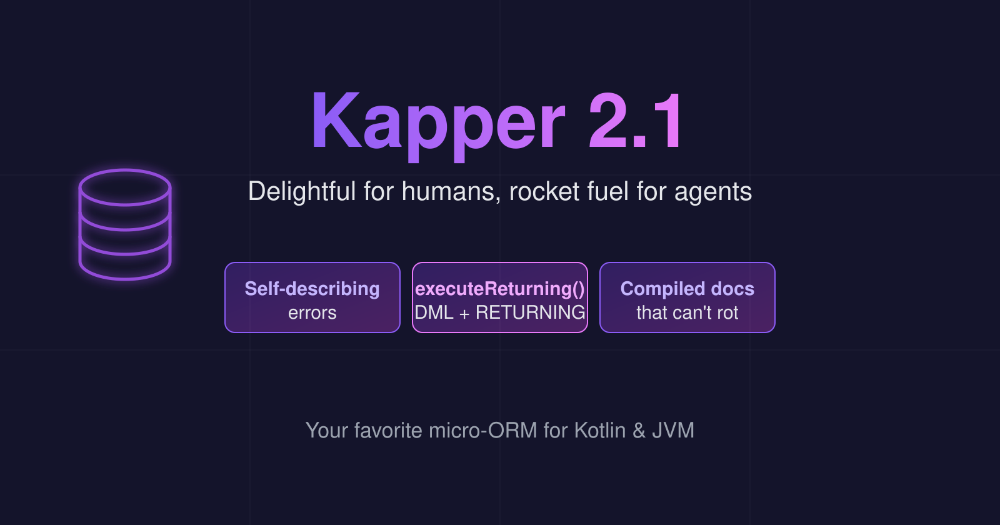

# Kapper 2.1: already delightful for humans, now rocket fuel for agents



It's been a while since our last post. Since [Kapper 1.6](https://driessamyn.github.io/kapper/blog/06_tying_up_loose_ends.html), we've shipped six releases — and somewhere along the way, the way people write SQL changed.

Most SQL is now written by an agent. That doesn't mean it shouldn't still be a pleasure for humans to write and read — it should. But it does change the calculus. A heavyweight framework like Hibernate or Spring Data exists to spare you from writing SQL. When the SQL is already written, that layer adds complexity, not value.

Kapper has always taken the opposite position: keep SQL front and centre, hide nothing, and tell you how to fix it when something goes wrong. What's new is that we've started taking "tell you how to fix it" seriously — for humans and agents alike.

This post covers everything since 1.6, and where we're heading.

## The road since 1.6

A lot has landed. Here's the short version:

| Release | What it brought |
|---|---|
| **1.6.2** | Query parsing no longer fails on untrimmed expressions |
| **1.7.0** | `BigDecimal` support for `DECIMAL` and `NUMERIC` |
| **1.7.1** | `withTransaction` restores the original autoCommit value; thread-safe date formatting |
| **1.8.0** | SQL array support (PostgreSQL, DuckDB); DuckDB and MariaDB support |
| **2.0.0** | `executeReturning` — DML statements with a `RETURNING` clause |
| **2.1.0** | Self-describing errors, a faster query path, coroutine refinements, compiled docs snippets, and a repositioning |

Let's take them in turn.

## For humans

### BigDecimal, done properly

`DECIMAL` and `NUMERIC` columns are how most databases represent money and other exact values. As of 1.7.0, they map to `java.math.BigDecimal` — no `Double` rounding surprises, no manual conversion:

```kotlin
data class Product(
    val id: UUID,
    val name: String,
    val price: BigDecimal,
)

val products = connection.query<Product>("SELECT id, name, price FROM products")
```

### SQL arrays

1.8.0 added support for SQL array types on PostgreSQL and DuckDB. Arrays map straight to Kotlin lists, including nested decimals and nullable arrays:

```kotlin
data class Article(
    val id: UUID,
    val tags: List<String>,           // String array
    val scores: List<Int>,            // Integer array
    val prices: List<BigDecimal>,     // Decimal array
    val optionalTags: List<String>?   // Nullable array
)
```

### More databases than ever

Kapper is "just" an extension of `java.sql.Connection`, so in principle it works anywhere JDBC does. In practice, "in principle" isn't good enough — so we built a unified compatibility test suite and ran it against more engines. Since 1.6 we've added **DuckDB**, **MariaDB**, **CockroachDB**, **YugabyteDB**, **StarRocks**, **TiDB** and **Firebird**, alongside the existing PostgreSQL, MySQL, SQLite, Oracle and SQL Server support.

The interesting part isn't the list — it's the harness. One parameterised suite, many engines, run in CI. That's what made it practical to grow the list quickly, and it's what keeps the claims honest.

### DML that returns rows: `executeReturning`

Sometimes you want to insert or update a row *and* get the resulting record back. PostgreSQL, DuckDB and others support this with a `RETURNING` clause, but routing DML through a query function was always a fragile workaround.

2.0.0 made it first-class:

```kotlin
val inserted: List<User> = connection.executeReturning<User>(
    "INSERT INTO users(id, name, email) VALUES(:id, :name, :email) RETURNING id, name, email",
    "id" to UUID.randomUUID(),
    "name" to "Wonder Woman",
    "email" to "wonder@dc.com",
)
```

There's an object-args variant too, so you can bind from a DTO and map the result to a different type:

```kotlin
val created: List<User> = connection.executeReturning<User, CreateUserRequest>(
    "INSERT INTO users(name, email) VALUES(:name, :email) RETURNING id, name, email",
    request,
    "name" to CreateUserRequest::name,
    "email" to CreateUserRequest::email,
)
```

2.0.0 was a major version, but the change was additive — there's no migration to do.

### The fixes that matter

Not everything is a headline feature. 1.6.2 fixed query parsing for untrimmed expressions. 1.7.1 fixed `withTransaction` so it restores the original autoCommit value, and replaced a `SimpleDateFormat` with a thread-safe `DateTimeFormatter`. Small things, but the kind that bite in production.

## For agents

This is where 2.1.0 earns its subtitle.

### Errors that tell you what to do

The single highest-value change for an agent is a good error message. An agent that gets a precise error fixes itself; an agent that gets a vague one guesses.

Before 2.1.0, a mapping failure looked like this:

```
net.samyn.kapper.KapperMappingException: Error creating mapper for class net.samyn.kapper.User
```

Now it looks like this:

```
net.samyn.kapper.KapperMappingException: Cannot map to net.samyn.kapper.User: the following
non-optional constructor parameters are missing: [name]. Columns returned: [id (UUID),
full_name (VARCHAR), email (VARCHAR)]. Expected constructor parameters: [id, name, email].
Hint: alias the columns (e.g. SELECT full_name AS name), or register a custom mapper.
```

It names the target class, the columns the query actually returned (with their JDBC types), the constructor parameters it expected, the specific mismatch, and a concrete remedy. Conversion failures and parse failures got the same treatment — a parse error now points at the offending character with a caret.

This is the change we're proudest of, and it's the one that most directly serves the "delightful for humans and agents alike" bar.

### A faster query path

2.1.0 also tightened the hot path. Parsed templates are now cached (bounded, hand-written — no new dependency), the database flavour is resolved once per query instead of twice, the record constructor is resolved once per mapper instead of once per row, and the `JDBCType` lookup is a static map instead of a linear scan.

None of it changes the API. All of it makes the common case faster. See the [performance benchmarks](https://driessamyn.github.io/kapper/performance/) for the numbers.

### Coroutines, tightened up

We also spent time on the coroutine module. `queryAsFlow` is now **cold** — it executes when collected, not when created — which also means an uncollected flow no longer holds a result set open. And `withConnection` now acquires and closes the connection on the dispatcher you specify, rather than on the caller's thread, so a blocking pool checkout can't stall an event loop.

### Docs that can't rot

Documentation that describes features that don't work is worse than no documentation. We'd drifted into that: the guide claimed enum support and scalar queries that the code didn't provide.

So the examples are now **compiled Kotlin**. Each snippet lives in a real Gradle module, is extracted from source by region markers, and is checked in CI — if a snippet stops compiling, or the generated page drifts from the source, the build fails. The [snippets page](https://driessamyn.github.io/kapper/guide/snippets) is generated from compiled code, not hand-written.

This matters more than it sounds. It's the single source of truth that the agent-facing artefacts below will build on.

### A brief for agents working on Kapper

We added [`AGENTS.md`](https://github.com/driessamyn/kapper/blob/main/AGENTS.md) — a short, hand-written brief covering the build commands, the integration-test setup, the coverage gate and the release conventions. It's deliberately specific and deliberately not generated: research shows that generic, LLM-written `AGENTS.md` files tend to *reduce* task success, so this one says only what an agent couldn't already guess.

## What's next

The repositioning is the start of a larger piece of work, and we want to be honest about what's shipped and what isn't.

**Shipped in 2.1.0:** self-describing errors, the compiled snippets pipeline, and `AGENTS.md`.

**In progress:** a machine-readable form of the docs (`llms.txt` and `llms-full.txt`), generated from the same source of truth as the snippets; a distributable skill so an agent working *with* Kapper gets the API, the binding rules and the common mistakes; and a `kapper-test` harness so an agent can run a query against an in-memory database and close the loop in seconds.

**Further out:** broader type coverage (enums, scalars, `Map<String, Any?>` rows, and a user-extensible converter registry), and — further still — a schema-aware MCP server that can introspect your schema, validate a template, and `EXPLAIN` a query.

One deliberate gate: we're building the retrieval artefacts now, but we won't drive traffic to them until the parser handles the awkward cases (time literals, emails, `:params` inside comments) correctly. Attracting agents to a library that fails on the first attempt is worse than not attracting them at all.

## Try it

Kapper 2.1.0 is on [Maven Central](https://central.sonatype.com/artifact/net.samyn/kapper). If you're on 1.x, the upgrade is straightforward — 2.0.0's change was additive.

Let us know what you think, what's missing, or what you'd like to see next. Open an issue on [GitHub](https://github.com/driessamyn/kapper) or reach out directly.

Let developers fall in love with SQL again — humans and agents alike.
