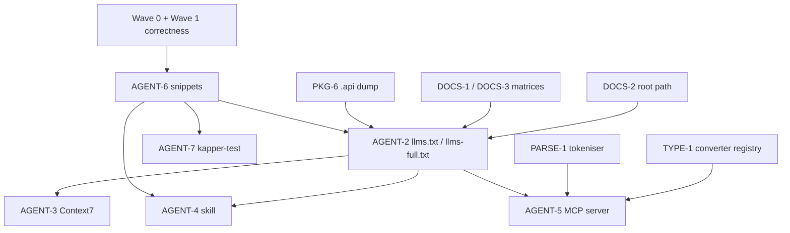

# Kapper v3 — Retrieval Chain Breakdown

**Scope:** AGENT-6 → AGENT-2 → AGENT-3, plus the single-source-of-truth design they depend on.
**Companion:** `kapper-v3-plan.md`.
**Gate:** this chain must not start until Wave 0 and the Wave 1 correctness items (PARSE-1, DIAG-1,
TYPE-2, TYPE-6) are done. Discoverability is a multiplier on correctness.

---

## 0. The single source of truth

The review proposes four artefacts that restate the same API surface and examples (AGENT-2, AGENT-4,
AGENT-6, and the existing `docs/guide/*`). The docs already contradict the code. Four more copies
will drift within a release. So the chain is built on one generated source.

### 0.1 Three generated inputs

| Input | Produced from | Consumed by |
|---|---|---|
| **Snippet set** | Compiled Kotlin in `docs-snippets/` + `docs/snippets.yaml` | snippets page, `llms-full.txt`, skill, guide pages |
| **API manifest** | The public API (`.api` dump from PKG-6, or Dokka JSON) | `llms-full.txt`, skill, API reference, `llms.txt` validator |
| **Matrices** | JUnit parameterised tests (DOCS-1, DOCS-3) | support matrix page, type matrix page, `llms-full.txt` |

### 0.2 Why compiled snippets, not markdown

A markdown snippet cannot be verified. A Kotlin snippet in a Gradle module is compiled by `check`,
so it cannot rot. Region markers let one file host several snippets:

```kotlin
// docs-snippets/src/main/kotlin/net/samyn/kapper/snippets/QuerySnippets.kt

// region: select-many
fun selectMany(connection: Connection): List<User> =
    connection.query<User>("SELECT id, name FROM users WHERE active = :active", "active" to true)
// endregion
```

### 0.3 Why a manifest, not a naming convention

`docs/snippets.yaml` is the contract. It carries the ID, source file, region, title, description,
tags, and the doc pages that embed it. A naming convention cannot express "this snippet appears on
the queries page and in the skill".

```yaml
# docs/snippets.yaml
- id: select-many
  file: docs-snippets/src/main/kotlin/net/samyn/kapper/snippets/QuerySnippets.kt
  region: select-many
  title: Select many rows
  description: Map a result set to a list of data classes.
  tags: [query, read]
  pages: [guide/queries, guide/snippets]
```

### 0.4 Generation pipeline

```
docs-snippets/*.kt ──compile──┐
docs/snippets.yaml ───────────┼──> generateSnippets ──> docs/_generated/snippets/*.md
                              │                        docs/guide/snippets.md
.api dump / Dokka JSON ───────┼──> generateApiManifest ─> docs/public/api-manifest.json
JUnit matrix tests ───────────┘──> generateMatrices ────> docs/public/matrices.json

docs/public/api-manifest.json ─┐
docs/_generated/snippets/*.md ─┼──> generateLlms (Node, in docs/) ─> docs/public/llms-full.txt
docs/public/matrices.json ─────┘                                     docs/public/llms.txt
                                                                     docs/public/**/*.md
```

### 0.5 Drift gate

CI runs the generators, then `git diff --exit-code` on the generated artefacts. Editing a snippet
without regenerating fails the build. This is the same pattern already used for the Gradle lock
files in `.github/workflows/build-and-test.yml`.

---

## 1. AGENT-6 — Canonical snippets page (with CI compile step)

**Goal:** one blessed, compiling example per common task, extracted from compiled code.

**Deliverables**

- `docs-snippets` Gradle module, wired into `settings.gradle.kts`, depending on `:kapper` and
  `:kapper-coroutines`.
- The snippet inventory (the 20 tasks the review lists).
- `docs/snippets.yaml`.
- `generateSnippets` Gradle task.
- Generated `docs/guide/snippets.md` + per-snippet fragments.
- CI drift check.
- VitePress sidebar entry.

**Files**

- `settings.gradle.kts` — add `include("docs-snippets")`.
- `docs-snippets/build.gradle.kts` — new.
- `docs-snippets/src/main/kotlin/net/samyn/kapper/snippets/*.kt` — new.
- `docs/snippets.yaml` — new.
- `buildSrc/src/main/kotlin/kapper.snippets.gradle.kts` — new (or a task in the root build).
- `docs/guide/snippets.md` — generated.
- `docs/.vitepress/config.ts` — sidebar entry.
- `.github/workflows/docs.yml` — drift check.

**Steps**

1. Add `docs-snippets` to `settings.gradle.kts`; apply the library conventions minus publishing.
2. Create `docs-snippets/build.gradle.kts` with `implementation(project(":kapper"))` and
   `implementation(project(":kapper-coroutines"))`.
3. Define the inventory. The review's list, plus two it omits:
   select many, select one, select scalar, insert, insert-and-return-id, update, delete, batch insert,
   transaction with return value, join, streaming, custom mapper, enum property, nullable column,
   `IN` list, `jsonb`, coroutines, testing, **connection setup**, **error handling**.
4. Write one snippet per task with region markers. Each must compile against the *post-v3* API, so
   this task depends on the Wave 1 correctness items.
5. Write `docs/snippets.yaml`.
6. Implement `generateSnippets`: read the manifest, extract regions, render markdown with a stable
   header, write `docs/_generated/snippets/<id>.md` and the combined `docs/guide/snippets.md`.
7. Wire the task into the docs build (`generateApiDocs` already exists as the pattern) and add the
   CI drift check.
8. Add the sidebar entry in `docs/.vitepress/config.ts`.

**Acceptance criteria**

- Every snippet compiles as part of `./gradlew check`.
- The generated page is byte-stable across runs.
- CI fails if a snippet is edited without regenerating.
- Every snippet has a unique ID and appears in `docs/snippets.yaml`.
- The page covers all 20 tasks.

**Effort:** S–M (~1–2 days; the inventory is the bulk).
**Dependencies:** Wave 1 correctness items (the snippets must show working code).
**Risks:** adds build time; the drift gate is the only thing preventing rot.

---

## 2. AGENT-2 — `llms.txt` / `llms-full.txt`

**Goal:** agent-consumable docs, generated from the single source of truth.

**Deliverables**

- `docs/public/api-manifest.json` — machine-readable signatures.
- `docs/public/matrices.json` — support + type matrices, generated from tests.
- `docs/public/llms-full.txt` — complete API surface + one worked example per feature.
- `docs/public/llms.txt` — the index.
- Per-page `.md` variants (the Stripe pattern).
- A validator for the llmstxt.org layout.
- Root-path fix (custom domain or root-level file).
- Static, agent-readable changelog.

**Files**

- `buildSrc/src/main/kotlin/kapper.apimanifest.gradle.kts` — new.
- `docs/scripts/generate-llms.mjs` — new.
- `docs/scripts/validate-llms.mjs` — new.
- `docs/public/llms.txt`, `docs/public/llms-full.txt` — generated.
- `docs/package.json` — new scripts.
- `docs/changelog.md` — make static.
- `.github/workflows/docs.yml` — wire generation + validation.

**Steps**

1. **API manifest.** Generate `api-manifest.json` from the public API. Prefer parsing the
   binary-compatibility-validator `.api` dump (PKG-6) — it is already checked in and CI-gated.
   Fall back to Dokka JSON output if the dump is too lossy. Fields per declaration: package, type,
   name, signature, params, return, KDoc summary, since-version.
2. **Matrices.** Have the DOCS-1/DOCS-3 parameterised tests emit `matrices.json` as a test artefact;
   copy it into `docs/public/` during the docs build.
3. **`llms-full.txt`.** Concatenate: manifest (signatures), one snippet per feature (from AGENT-6),
   the matrices, and the version substitution (`%kapper_version%` is already handled in
   `docs/.vitepress/config.ts`). Enforce a size budget (target < 100k tokens) and fail the build if
   exceeded.
4. **`llms.txt`.** Hand-written index (one H1, blockquote summary, annotated link sections).
5. **Validator.** Check the llmstxt.org layout: one H1, a blockquote, valid link sections; check that
   every public API in the manifest is referenced; check that every linked page exists.
6. **Per-page `.md`.** Emit a `.md` variant of every page (the Stripe pattern).
7. **Serve + regenerate.** Output to `docs/public/` so VitePress copies them to the site root of the
   base path; regenerate on every docs build.
8. **Root-path fix.** Because `base: '/kapper/'`, the files land at `driessamyn.github.io/kapper/llms.txt`.
   The convention expects a domain root. Either adopt the custom domain (DOCS-2) or publish a
   root-level redirect. This is a prerequisite for AGENT-3.
9. **Static changelog.** Replace `<DynamicChangelog />` in `docs/changelog.md` with a build-time
   fetch of GitHub releases, so the static HTML contains the content.
10. **CI.** Add generation + validation to `.github/workflows/docs.yml`, with a `git diff --exit-code`
    drift check.

**Acceptance criteria**

- Both files are served from the docs site and regenerated on every docs build.
- `llms-full.txt` is within the size budget and contains every public API in the manifest.
- The validator passes against the llmstxt.org layout.
- The changelog is present in the static HTML.
- CI fails on drift.

**Effort:** M (a few days).
**Dependencies:** AGENT-6 (snippets), PKG-6 (`.api` dump), DOCS-1/DOCS-3 (matrices), DOCS-2 (root path).
**Risks:** manifest parsing fragility; size budget; the base-path issue is easy to miss.

---

## 3. AGENT-3 — Context7 submission

**Goal:** presence in the retrieval path agents actually use.

**Deliverables**

- Context7 submission.
- A re-index trigger on release.
- A verification check.
- A success metric.

**Files**

- `.github/workflows/mc-publish.yml` or a new workflow — re-index trigger.
- `docs/scripts/verify-context7.mjs` — new.

**Steps**

1. Verify the AGENT-2 artefacts are live and correct (both files, correct content, correct path).
2. Submit the project to Context7.
3. Add a re-index trigger on release (the docs already deploy on `release: published` in
   `.github/workflows/docs.yml`; hook the re-index there).
4. Add a verification check: query the Context7 search API for "kapper" and assert it resolves to
   this project.
5. Add a success metric: record agent-traffic signals (docs-site referrers, Context7 usage if
   exposed, MCP call counts once AGENT-5 exists).

**Acceptance criteria**

- Searching Context7 for "kapper" resolves to this project.
- Re-index happens on release.
- The verification check runs in CI (or a scheduled job) and fails loudly if the index disappears.
- A metric is recorded and reviewed.

**Effort:** S (~1h, plus the metric plumbing).
**Dependencies:** AGENT-2.
**Risks:** external dependency; index drift; no metric means no way to know it worked.

---

## 4. Dependency graph



---

## 5. CI wiring

Extend `.github/workflows/docs.yml`:

```yaml
- name: Generate snippets, API manifest and matrices
  run: ./gradlew generateSnippets generateApiManifest generateMatrices

- name: Generate llms.txt artefacts
  run: npm run generate:llms
  working-directory: docs

- name: Validate llms.txt layout
  run: npm run validate:llms
  working-directory: docs

- name: Fail on drift
  run: git diff --exit-code -- docs/public docs/guide/snippets.md docs/_generated
```

The `docs-snippets` module is compiled by `./gradlew check` in
`.github/workflows/build-and-test.yml`, so a non-compiling snippet fails the main build.

---

## 6. Risks

| Risk | Mitigation |
|---|---|
| Snippets rot | Compiled in `check`; drift gate in CI |
| `llms-full.txt` drifts from the API | Generated from the manifest; validator checks coverage |
| Base path hides `llms.txt` | Custom domain (DOCS-2) or root-level redirect |
| Manifest parsing is fragile | Prefer the `.api` dump; fall back to Dokka JSON; test the parser |
| Size budget exceeded | Enforce in CI; trim prose, keep signatures + one example per feature |
| Context7 index drifts | Re-index on release; verification check |
| No way to know it worked | Success metric (step 3.5) |
